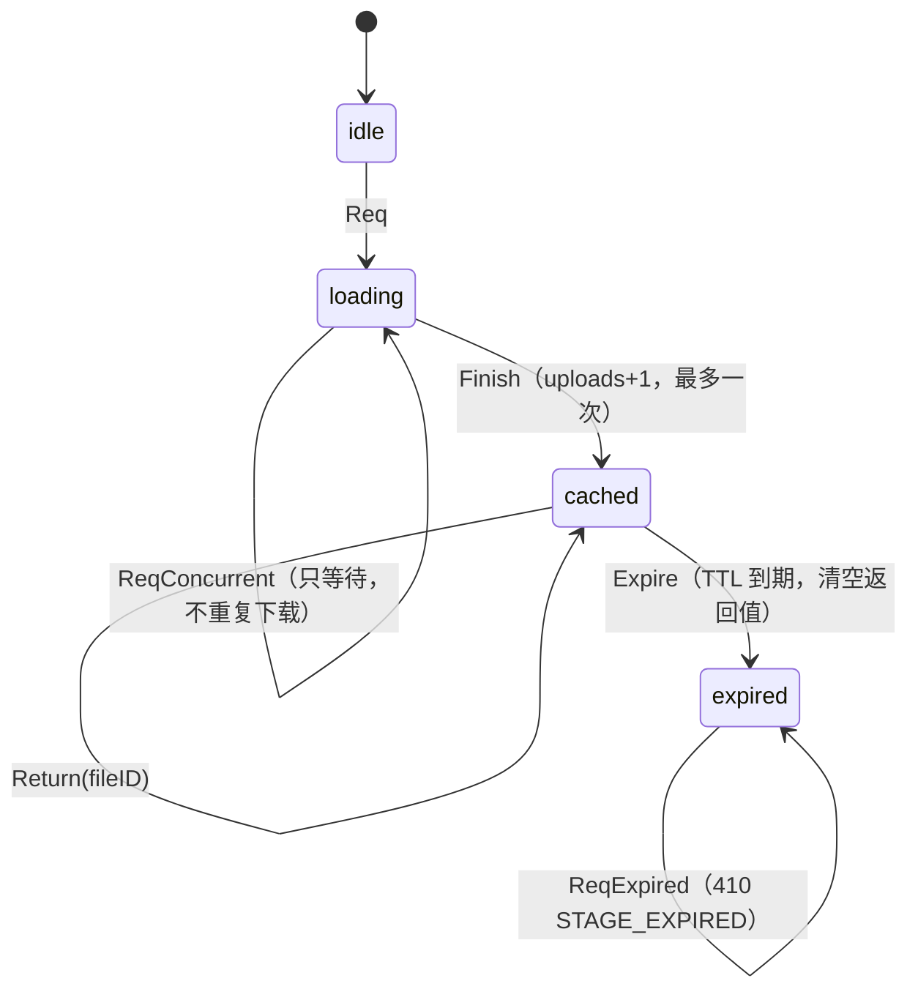

# /stage 幂等领域状态机（TLA+）

- 模型：`statechart.tla`（好版本）、`statechart_buggy.tla`（故意去掉幂等守卫）
- 工具：TLC（`tla2tools.jar`），SC 范围 7 个状态，秒级跑完
- 目的：证明「同一 `(task_id,index)` 不会重复上传、不会返回半成品或过期 ID」

## 状态图



## 不变量

| ID | 人话 | 形式化 |
|---|---|---|
| I1 | 同一 (task_id,index) 最多上传一次 | `NoDoubleUpload == uploads <= 1` |
| I2 | 只有上传成功后才能返回 fileID | `IDsOnlyAfterUpload == responded = "id" => uploads >= 1` |
| I3 | 过期后不得返回旧 fileID | `ExpiredNoStaleID == status = "expired" => responded /= "id"` |

## 验证结果

```bash
java -cp ~/.local/opt/tla/tla2tools.jar tlc2.TLC -config statechart.cfg statechart.tla
# Model checking completed. No error has been found.
# 11 states generated, 7 distinct states found, depth 5
```

坏版本（`Finish` 不改变状态，允许重复上传）：

```bash
java -cp ~/.local/opt/tla/tla2tools.jar tlc2.TLC -config statechart_buggy.cfg statechart_buggy.tla
# Invariant NoDoubleUpload is violated.
# 违例路径：Req → Finish(uploads=1) → Finish(uploads=2)
```

## 边界

- 验证的是模型，不是全部实现；模型之外的行为（网络错误、转码失败）由 tests 覆盖。
- 状态空间限制在 `uploads/inFlight ∈ 0..2`，足以覆盖并发重复请求。
- 代码变更后，先确认 `internal/.../stage` 的守卫仍与模型一致，再移动 `sync commit`。
